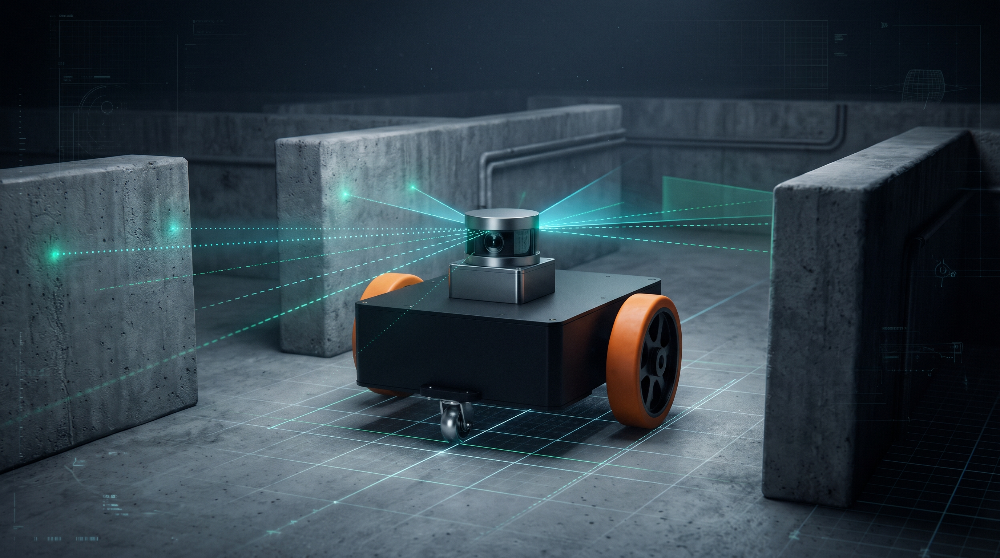

# Autonomous Obstacle-Avoidance Mobile Robot

<p align="center">
  
</p>

An autonomous differential-drive mobile robot developed using **ROS 2 Jazzy** and **Gazebo Harmonic**. The robot uses a 360° 2D GPU LiDAR sensor and a custom Python-based reactive obstacle avoidance algorithm to navigate through a custom 14 × 14 maze.


This is a simulation-only project. It does not rely on SLAM, map generation, or Nav2.

## Project Demo

<!-- Add your simulation video here -->
[Watch the Simulation Demo](media/demo.mp4)

## Features

- Autonomous navigation using a custom Python obstacle avoidance algorithm.
- 360° 2D GPU LiDAR for real-time obstacle detection.
- Reactive navigation without SLAM or mapping.
- Automatic selection of the clearer direction when an obstacle is detected.
- Direction locking with hysteresis to reduce unnecessary left-right switching.
- U-shaped dead-end detection and escape, tested successfully.
- Custom 14 × 14 Gazebo maze environment.
- Real-time visualization in RViz2:
  - Robot model
  - LiDAR scan
  - TF transforms
  - Odometry
- Unified ROS 2 launch file to start the simulation.

## System Architecture

The project is organized into three ROS 2 packages inside the `modeling_ws` workspace.

| Package | Type | Responsibility |
|---|---|---|
| `edges_description` | `ament_cmake` | Robot model, Gazebo plugins, maze world, and RViz configuration |
| `obstacle_avoidance_controller` | `ament_python` | Custom Python obstacle avoidance controller |
| `edges_bringup` | `ament_cmake` | Unified simulation launch and system integration |

### Main Components

**Robot Description — `edges_description`**
- `edges_mobile_robot.xacro`: Differential-drive robot model.
- `obstacle_world.sdf`: Custom maze environment.
- `edges_config.rviz`: RViz2 visualization configuration.
- Gazebo plugins for differential drive, joint states, and GPU LiDAR.

**Obstacle Avoidance — `obstacle_avoidance_controller`**
- `obstacle_avoidance_node.py`: Processes LiDAR data and generates velocity commands.
- `obstacle_avoidance.yaml`: Controller configuration.

**Bringup — `edges_bringup`**
- `autonomous_robot.launch.py`: Starts Gazebo, robot spawning, ROS-Gazebo bridges, RViz2, and the obstacle avoidance controller.

## Obstacle Avoidance Algorithm

The robot uses a reactive obstacle avoidance strategy based on real-time LiDAR measurements.

1. **LiDAR Processing:** Subscribes to `/scan` and analyzes the surrounding environment.
2. **Front Obstacle Detection:** Checks a front field of view of ±30°.
3. **Safe Distance:** Uses 0.85 m as the obstacle detection threshold.
4. **Forward Motion:** Moves forward at 0.45 m/s when the path is clear.
5. **Direction Selection:** Compares average free distances on the left and right sides and selects the more open direction.
6. **Direction Lock with Hysteresis:** Prevents rapid switching between left and right directions.
7. **Dead-End Escape:** Performs a 180° turn to escape U-shaped dead ends.

The controller publishes velocity commands through `/cmd_vel`.

## ROS 2 Topics

The simulation uses `ros_gz_bridge` to connect Gazebo topics with ROS 2.

| Topic | Description |
|---|---|
| `/scan` | 360° LiDAR measurements |
| `/cmd_vel` | Robot velocity commands |
| `/odom` | Odometry data |
| `/tf` | Coordinate frame transforms |
| `/joint_states` | Wheel joint states |
| `/clock` | Simulation clock |

## RViz2 Visualization

RViz2 provides real-time visualization of the robot model, LiDAR measurements, TF frames, and odometry.

<!-- Add your RViz2 screenshots inside media/screenshots/ -->


## Engineering Challenges and Solutions

**1. TF Tree Integration**

Configured the differential-drive plugin with:
- `frame_id`: `odom`
- `child_frame_id`: `base_footprint`

Integrated the joint state publisher and `/joint_states` bridge to maintain the robot's TF tree and visualization in RViz2.

**2. Simulation Startup Synchronization**

Used `TimerAction` in the launch file to delay controller startup until the Gazebo world, robot spawning process, and required bridges are ready.

**3. U-Shaped Dead-End Navigation**

Implemented a dead-end escape behavior using a 180° turn to help the robot recover when forward navigation is blocked.

## Technologies

- ROS 2 Jazzy
- Ubuntu 24.04
- Gazebo Harmonic
- Python 3
- CMake
- Xacro / URDF
- SDF
- RViz2
- `ros_gz_bridge`
- LiDAR-based reactive navigation

## Installation and Execution

### Prerequisites

- Ubuntu 24.04
- ROS 2 Jazzy
- Gazebo Harmonic
- `ros_gz` integration packages
- Colcon build tools

### 1. Clone the Repository

```bash
git clone https://github.com/YOUR_USERNAME/autonomous-obstacle-avoidance-robot.git
cd autonomous-obstacle-avoidance-robot
```

### 2. Build the Workspace

```bash
cd ~/modeling_ws
colcon build --symlink-install
```

### 3. Source the Workspace

```bash
source install/setup.bash
```

### 4. Launch the Simulation

```bash
ros2 launch edges_bringup autonomous_robot.launch.py
```

The launch file starts the complete simulation system.

## Project Status

**Completed and tested.**

- Simulation environment implemented.
- Custom reactive obstacle avoidance controller implemented.
- LiDAR-based navigation tested.
- U-shaped dead-end escape tested successfully.
- RViz2 visualization configured.

## Future Improvements

- Implement SLAM and autonomous mapping.
- Integrate ROS 2 Nav2 for map-based navigation.
- Test the controller on a physical differential-drive robot.
- Improve navigation performance in more complex environments.

## Author

**Ashraf Barakat**

Individual Project
